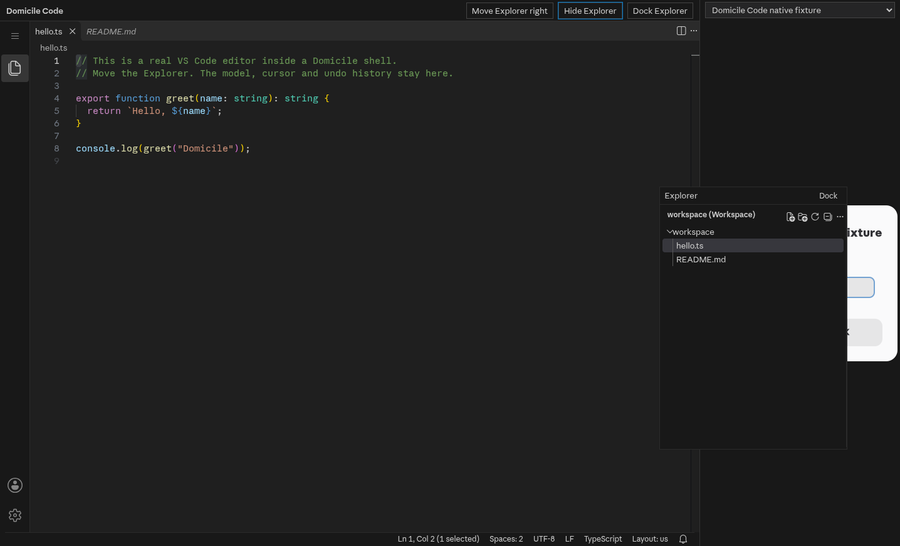
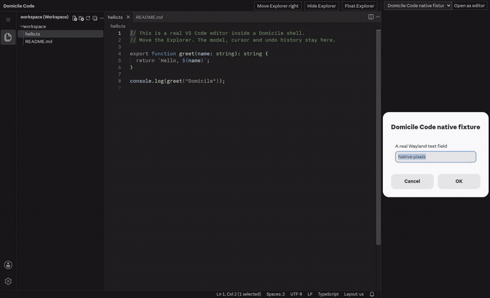
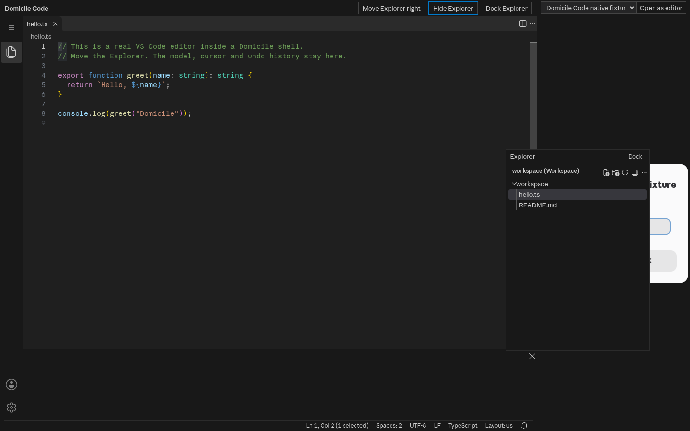

# Domicile Code

A bounded experiment in making a real VS Code workbench into a [Domicile](https://github.com/cprussin/domicile) desktop shell.

The shell independently arranges the real Explorer, editor and native application surfaces. A working prototype and checked demonstrations are available in [draft PR #1](https://github.com/mecattaf/domicile-code/pull/1). The implementation remains on its [build branch](https://github.com/mecattaf/domicile-code/tree/build/free-compute-spike-20261114); this landing page presents the implemented behaviors and their limits.

## What Domicile can do when VS Code is its shell

**Detach the real Explorer.** Move VS Code's actual sidebar Part out of the workbench grid, float it over a live native application, open another file, then dock the same Part. The editor model, selection and native process survive the layout changes. One workbench service graph owns the parts.

[](media/explorer-floating.mp4)

[▶ Watch: detach, drag, open a file and dock — 18 seconds](media/explorer-floating.mp4) · [Reproduction and identity checks](https://github.com/mecattaf/domicile-code/blob/10354c0/evidence/2026-11-14-floating/README.md)

**Put a running native application in an editor tab.** A real Wayland dialog becomes a VS Code editor Pane. It accepts keyboard input, parks while a text tab is active, reappears with its state, and returns to its desktop pane when the editor closes. The same `<app>` element and native client remain alive throughout.

[](media/native-editor.mp4)

[▶ Watch full-resolution video: native app → editor tab → text tab → desktop pane — 18 seconds](media/native-editor.mp4) · [Screenshot](media/native-editor.png) · [Reproduction and native stdout checks](https://github.com/mecattaf/domicile-code/blob/10354c0/evidence/2026-11-15-native-editor/README.md)

These videos record the implemented shell on Strix Halo through CDP. Their exact isolated diagnostic setup is retained in the reproduction receipts. They demonstrate composition and retained state; they are not performance benchmarks. No Domicile engine change was needed for these features.

## Direct Domicile validation

Domicile is the Wayland compositor and daily driver on both the Zenbook and Strix Coordinator. The prototype is a shell for that compositor. Our separate latest main/stable retest at `1557378783d6bf7c94a5c093f3fe42804652a540`, official engine `sa6e192f40495`, passes real Explorer floating/dragging/docking, CLI query agreement and native screenshot capture through Domicile's direct software-headless backend.



[Read the direct retest and exact limits](https://github.com/mecattaf/domicile-code/blob/10354c0/evidence/2026-11-15-direct/README.md). Those isolated tests did not measure the hosts’ normal direct DRM/GPU sessions, EIS end-to-end or hardware encoding. A complete IDE remains beyond this spike. CDP is an acceptable observation/recording path for this experiment; native screenshot and ScreenCast/PipeWire interfaces are documented separately in the evidence.

## Why this is a shell

Domicile's shell document embeds native application and browser surfaces. VS Code supplies its workbench Parts and services. The experiment joins those responsibilities: a shell arranges actual Parts and native surfaces while preserving their state and identity. It uses monaco-vscode-api's Parts-hosting seam, one service graph and a small in-memory file fixture.

## Reproduce and contribute upstream

- [Run the prototype](https://github.com/mecattaf/domicile-code/blob/10354c0/docs/run-prototype.md), [build status](https://github.com/mecattaf/domicile-code/blob/10354c0/docs/build-status.md) and [proof receipts](https://github.com/mecattaf/domicile-code/blob/10354c0/PROVE.md).
- [Scope and acceptance](SCOPE.md) and [current specification](https://github.com/mecattaf/domicile-code/blob/10354c0/SPEC.md).
- [Upstream findings and contribution index](https://github.com/mecattaf/domicile-code/blob/build/free-compute-spike-20261114/docs/upstream.md): minimal reproductions, exact engine pins, working controls and reusable contract questions.
- [Sources](https://github.com/mecattaf/domicile-code/blob/10354c0/docs/sources.md) and [the domicile-handoff precedent](https://github.com/mecattaf/domicile-handoff).

The useful result is a small implementation with honest evidence: what works, what fails, which existing mechanisms are sufficient, and which Domicile improvements would help other shells too. Host filesystem access, Node extensions, PTYs, Git/debugging, arbitrary native applications and broad desktop reliability are further work. A complete general-purpose IDE is outside this first spike.

## Build this branch

Use Node 24 and the committed lockfile:

```sh
npm ci --ignore-scripts
npm run check
npm run build
```

`dist/browser/` is a browser reference that explicitly marks native composition unavailable. `dist/shell/shell.js` exports Domicile's named `Shell` entry and includes its stylesheet and worker assets. See [the runbook](docs/run-prototype.md), [build status](docs/build-status.md) and [upstream index](docs/upstream.md#submitted-upstream-reports) for the tested loading contract and remaining limits.
