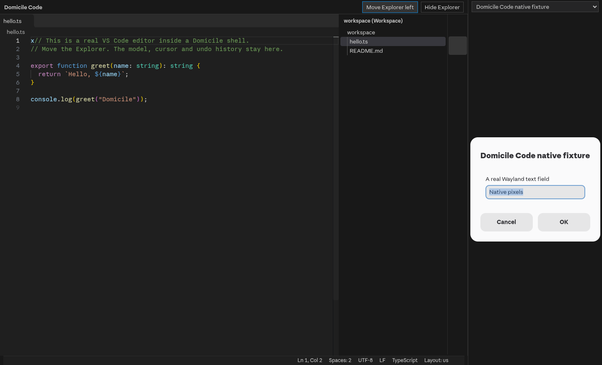
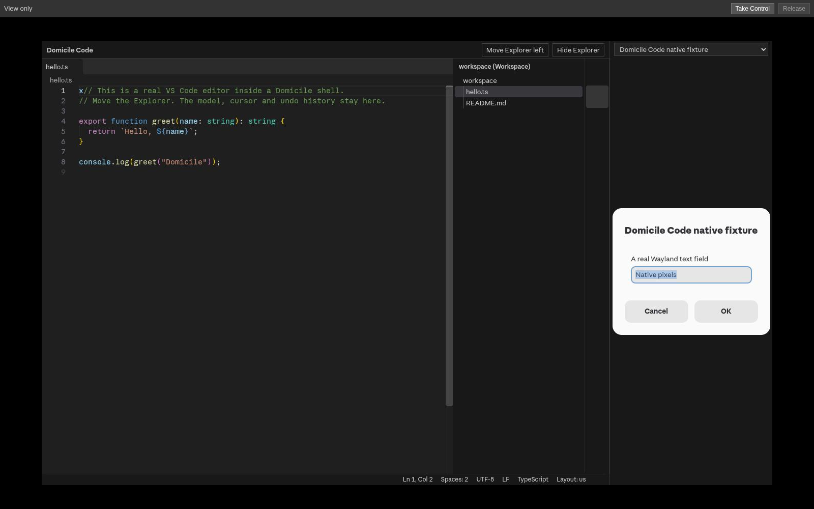

# Initial end-to-end evidence

The graphical server is the Strix Halo prototype. The client check ran on the actual Zenbook Duo through a loopback SSH tunnel. Its isolated headless browser used the same viewer interface that a person opens; subjective latency and physical keyboard coverage still need human review.

Source boundaries: shell and tooling checkpoints `5416a2f`, `0fa8b0d` and `ab4daa1`, with the exact test-script changes recorded in each receipt. Domicile and engine pins are in [build status](../../docs/build-status.md). IDs in these receipts identify the selected test desktop, rather than account credentials.

## What passed

[Watch the checked 18-second live clip](core-demo-cfr.mp4). It is an excerpt from a longer bounded recording of the shared viewer's real JPEG frames. Frame receive intervals preserve the source timing; the encoder repeats unchanged frames at a regular presentation rate. The clip has no audio and is not a performance benchmark. [Media probe](video-probe-cfr.json) and [actual browser playback](playback.json) establish finalization and playback.

- [Lifecycle receipt](lifecycle-03-pass.json): actual editor input, real Part DOM identity, model and selection retention, unchanged native process/surface identity, and functioning undo after moving, hiding and restoring the Explorer.
- [Native input receipt](native-input-02-pass.json): a fresh source image and scene were checked; keyboard input reached a real Wayland fixture; its independent stdout returned exactly `Native verified`; closing it cleared the native selection. The workbench model also remained unchanged.
- [Zenbook viewer receipt](viewer-02-pass.json): the viewer and builder named the same source, output and geometry; viewer input changed the actual layout and model; human takeover invalidated the agent's prior input epoch; reconnect retained the desktop, model and native process and returned in view-only mode.
- [Refused point](native-point-refused.json): a free image worker's proposed point lay outside the observed native window. The fixture driver rejected it before sending input. A successfully decoded image does not establish accurate spatial grounding.

## Failed attempts retained

| Receipt | What it revealed | Correction |
|---|---|---|
| [Lifecycle attempt](lifecycle-01-fail.json) | TypeScript comment continuation changed the expected inserted text. | Use a controlled single-key edit for the state-retention check. |
| [Undo attempt](lifecycle-02-fail.json) | The test assumed a multiword insertion formed a particular undo group. | Test retention with a single physical key and its real undo history. |
| [Native input attempt](native-input-01-fail.json) | A browser text helper produced lowercase on the native client. | Send a physical Shift event for capital letters; qualify broader text and IME separately. |
| [Viewer attempt](viewer-01-fail.json) | Capture correctly refused a scene that changed during the screenshot, but the test ignored its error acknowledgement. | Handle the explicit refusal and request another observation within a bounded wait. |

## Reproduction contract

Use the committed lockfile and the runtime pins. Start a private prototype session through the declared `runtime-test` wrapper. Add the public Zenity entry fixture titled `Domicile Code native fixture`, with its result redirected to a run-specific file. Use the source's explicit CDP target ID; the tools refuse a missing target instead of selecting another page.

The checks are `scripts/check-session.mjs`, `scripts/observe-session.mjs`, `scripts/check-native.mjs` and `scripts/check-viewer-client.mjs`. They require explicit endpoint, target or observation paths and write receipts to a selected output directory. The native fixture check currently qualifies US-layout letters, digits and spaces. It does not claim arbitrary Unicode or input-method support.

Raw account/provider inventories and private request ledgers remain outside this repository. The exported receipts contain fixture content; source checkout paths in errors were shortened while the original private receipts were retained.
