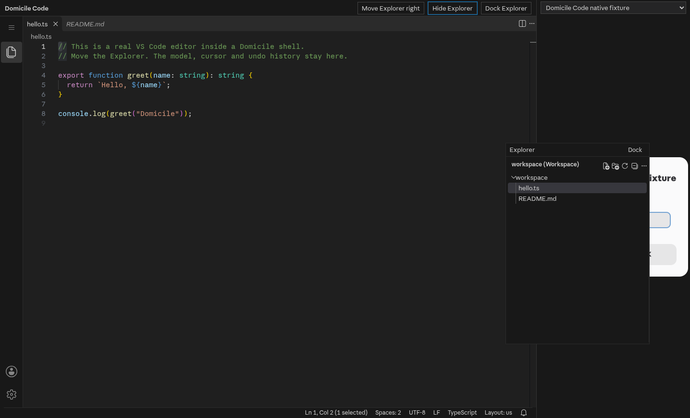

# Floating the real Explorer over a native application

[Watch the checked 18-second clip](floating-demo.mp4). The shell detaches the actual VS Code Explorer from its grid, drags it over a live Wayland dialog, opens `README.md` from the overlapping area, then docks the same Part again. This is one workbench service graph in one shell document, rather than multiple editor instances.

The [receipt](receipt.json) checks the original DOM Part, active model, nonempty selection and native process/surface identity across detach, hide/reveal and drag. Opening a different file changes the active model as expected; docking preserves that newly active model. The test restores `hello.ts` afterward. The native application remains a live surface behind the floating Part.

The source was the isolated GPU session described in [build status](../../docs/build-status.md), with shell changes based on `a0668da`. All actions used the shared viewer's leased input protocol. Browser debugging was used only to inspect DOM identity and control geometry. The clip comes from the same viewer's real JPEG frames, with source timing preserved and unchanged frames repeated at 25 fps. It has no audio and makes no encoding or latency performance claim.

The full MP4 decoded without errors and [played in Chromium](playback.json). [SHA-256 hashes](sha256.json) identify the exported files. The ordinary browser reference also passed editing, floating, dragging and docking checks with native composition explicitly unavailable.

Earlier drag attempts failed because the viewer adapter sent no held mouse button on CDP move events. Supplying the held button fixed pointer capture. A shell-focus change did not fix that failure. This was an adapter defect, not evidence of a Domicile input defect. Failed receipts are retained privately with the full run log; public proof rows retain their outcome and correction.
