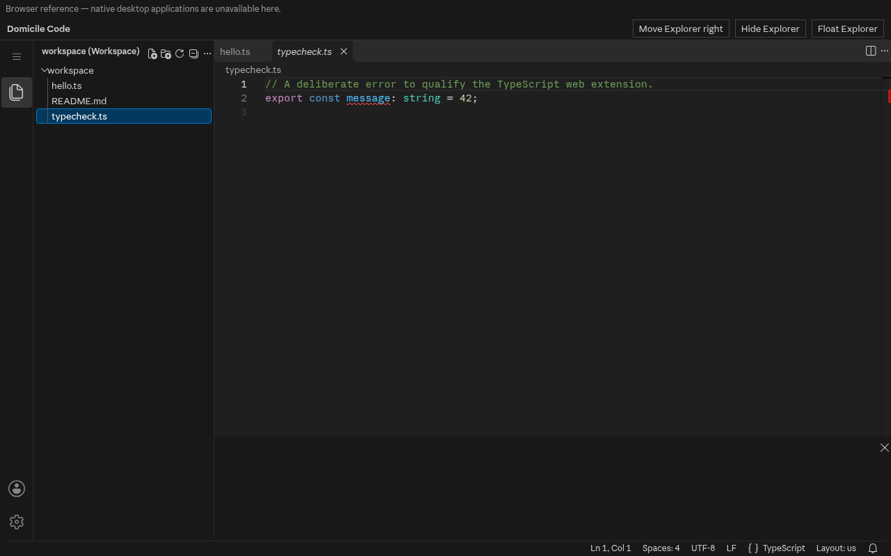
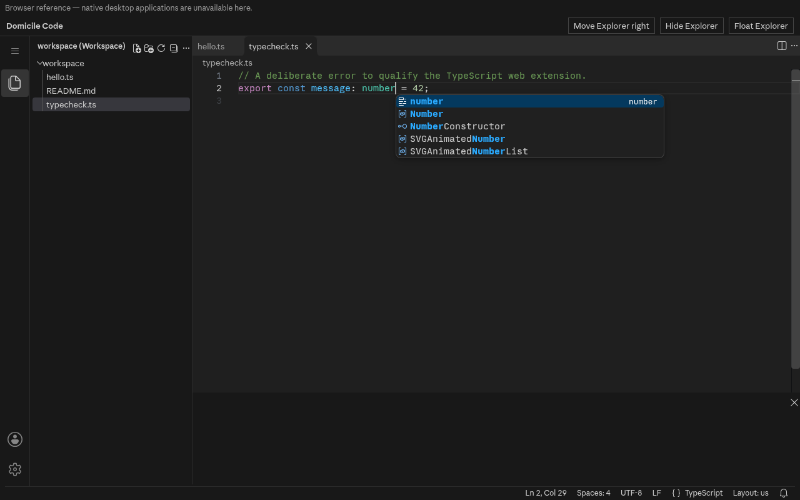

# Real language diagnostics in the isolated browser lane

[Language receipt](language-browser.json): the real TypeScript web extension reports diagnostic 2322 in the public fixture, and keyboard input corrects the type and clears it. The test uses the explicit experimental build mode; it does not qualify Domicile language support. The browser's iframe sandbox warning is retained. Only the selected built-in extension is part of this lane.

[Browser platform control](browser-platform.json): both classic and module workers receive a shared buffer and increment its value from 41 to 42 in a cross-origin-isolated context. [Domicile platform measurement](domicile-platform.json): the secure shell lacks cross-origin isolation and SharedArrayBuffer; the same worker script fetches with status 200 and `text/javascript`, but both worker main-script requests abort. Its `pass` means those explicitly selected unavailable/error expectations were observed, not that the capabilities work.

Two earlier browser attempts without isolation timed out waiting for semantic diagnostics. Their source status showed the extension activated without runtime errors. The initial worker-probe test also failed because it required a worker reply that the native route did not provide. Those failures remain in the private run history; the revised probe explicitly measures transport errors separately from shared-memory availability.
