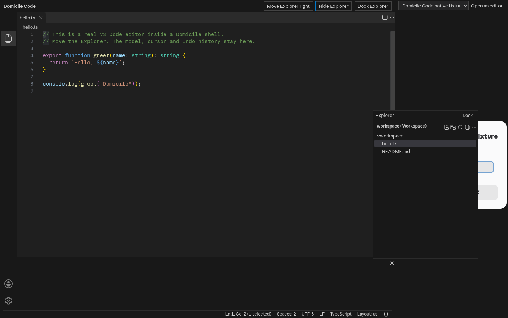

# Latest Domicile: direct desktop and upstream coverage

Measured 15 November 2026, 09:33–09:38 UTC, on Strix Halo. Main and stable both resolved to `1557378783d6bf7c94a5c093f3fe42804652a540`; official engine `sa6e192f40495`, engine commit `f60deb17be6d1cff7d2cbb36b75c7329f56a905f`, identity `a6e192f40495c44ab81263e93defcd7557e491a78cf6dc4a6c882b94fad67f36`. The tested Code build is `cb023b02243ad34f8702153656dc134fbcec003b`. The Nix package was updated and built in a scratch checkout on the compute host; the login system configuration was not switched.

The intended deployment is **direct Domicile, without Sway**. Every test compositor used the declared `runtime-test` isolation on the execution host. The direct tests used upstream's supported `OZONE=headless` backend, which deliberately composites in software. They do not qualify the direct DRM/GPU path.

| Axis | Latest result | Evidence |
|---|---|---|
| Direct native screenshot, minimal shell + real Wayland app | Both native CLI and CDP produce valid 1024×768 PNGs with the native dialog | [Capture receipt](capture.json), [native PNG](native-capture.png) |
| Real Code shell on a direct virtual monitor | 1440×900; Explorer float/hide/drag/file-open/dock retain Parts and state | [Floating receipt](floating.json), [image](direct-floating.png) |
| Programmatic shell queries | Discovery, read-only refusal and CLI/live-state agreement pass | [Query receipt](query.json) |
| Native screenshot of the real Code shell | CLI succeeds, visibly includes the real workbench and native surface | [PNG](direct-shell-native.png) |
| Dedicated worker scripts under shell origin | Fetch 200, classic and module worker start both abort | [Worker receipt](isolation.json) |
| Isolated/shared-memory context | Secure context true; crossOriginIsolated false; SharedArrayBuffer unavailable | [Worker receipt](isolation.json), [working HTTP control](../2026-11-14-language/browser-platform.json) |
| Explicit prebuilt module | Import-like UI text still routes to builder; control loads directly | [Fixture error](classification-shell.js.stderr.txt), [control stderr](classification-control.js.stderr.txt), [minimal pair](../../repros/import-classification/) |
| Latest official engine logical Wayland chords, reduced nested control | All nine logical-key controls pass | [Comparison](latest-keys.json), [events](latest-key-events.json) |
| Native capture in a reduced nested GPU control | Native CLI gets no compositor answer; CDP produces native pixels | [Receipt](nested-capture.json), [CDP PNG](nested-cdp.png) |

## What improved and what the tests taught us

The latest official engine supplies the newer CLI/query contracts and passes the logical Wayland-key control. The Code shell's decomposition and native surface composition work directly. Earlier checked-engine keyboard aborts remain a separately pinned development-build finding; this pass does not establish which source or build flag accounts for the difference.

Adding the virtual monitor replaced the initial placeholder page target. The first driver attempt retained its stale target and was refused by the viewer. The corrected driver reacquires the unique shell target in the same owned browser before acting. This is a harness correction and a useful source-generation lesson, not proof of a Domicile defect.

The user-facing preview was stopped at 09:28:50 UTC. Every retest was stopped after measurement. Interrupted Domicile exits and minidumps were retained privately; these are functional checks, not a clean-shutdown qualification. One minimal capture dump's exception stream reports `0xffffffff`; no root cause is asserted. Raw profiles, dumps and host environments are excluded.

## CDP and native capture are both legitimate

**CDP** captures the shell page through the engine's debugging endpoint. In these tests it includes Domicile's composited native `<app>` pixels. It also supports our shared viewer's observation/input loop. Our MP4 demonstrations encode those captured frames; they do not prove native video recording, audio or hardware encoding.

**Native capture** means Domicile's `screenshot` command and, separately, its ScreenCast/PipeWire recording interfaces. Only the screenshot command was exercised here. Portal authorization, recording/audio lifecycle and encoder performance remain unqualified. The native screenshot works directly in software but fails in the reduced nested GPU comparison. The differing results are not a demonstrated root cause.

CDP is an acceptable supported solution for this experiment. An upstream response of **“use CDP for capture” is entirely satisfactory**. Reporting the native-path discrepancy still helps other shells and users who depend on native screenshots or screen sharing. No new recorder is presumed necessary.

[driver.py](driver.py) is the exact fixed-path measurement harness for the direct runs, invoked through `runtime-test`; it is a pinned reproduction artifact rather than a portable launcher. The retained run receipts identify owned browser targets and private namespaces. GPU controls use the existing isolated launcher and minimal repros, solely to characterize edge cases; Sway is not the deployment target.
